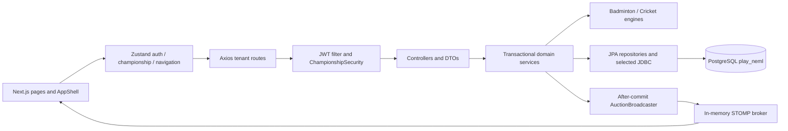

# Play-Neml — Phase 0 architecture audit and implementation roadmap

Audit date: 2026-10-27 (Asia/Calcutta). Scope: repository setup, architecture review, baseline validation, and planning only. No feature, dependency, branding, schema, authentication, or authorization changes were implemented.

Completed on resume using the original evidence; successful expensive checks were not rerun. See [PHASE-1-PLAN.md](PHASE-1-PLAN.md) for the ordered stabilization backlog, [INVENTORY.md](INVENTORY.md) for source locations, and [evidence/README.md](evidence/README.md) for provenance and limitations.

## Repository and isolation

- Verified origin: `https://github.com/kartnagrale/sports-play-v2.git`; repository name unchanged.
- Fetched `origin/main` successfully. Remote main and the supplied merge baseline both resolve to `636f30d11ae50b300f32d96f6a901c908dfb2433`.
- Created `feature/play-neml-upgrade` from that fetched revision; the branch did not previously exist.
- Audit checkout: `C:/Users/karti/.codex/worktrees/play-neml-upgrade/sports-play-main`.
- Original checkout remains on `main` at `C:/Users/karti/personal_projects/sports-play-main`. Preserved its modified `.gitignore` and untracked `.agents/`, `.claude/`, `brag-output-2026-09-25-032000/`, `docs/architecture/Sports-Play-Platform-Complete-User-Guide.docx`, `docs/architecture/assets/`, `skills-lock.json`, and `tools/`. Audit staging helpers were written only under its ignored `tmp/` directory.
- The pre-existing verification worktree was not reused or modified. No stash, reset, merge, remote push, or modification of main was performed.
- Product documentation uses **Play-Neml**. Java packages (`com.neml.badminton`), schema (`play_neml`), artifact names and identifiers remain unchanged. `https://play.neml.in` is a future deployment target; DNS, TLS and hosting were not assumed or tested.

## Fresh baseline results

| Check | Result | Evidence |
|---|---|---|
| Maven clean verify, Java 17 | PASS: 32 tests, 0 failures/errors/skips; executable JAR packaged | `evidence/backend-java17-verify.log`, `maven-java17-version.log` |
| Initial machine-default Java 25 run | FAIL: 32 tests, 3 errors; Byte Buddy supports through Java 22 and rejects Java 25 | `evidence/backend-verify.log`, `maven-version.log` |
| Locked frontend install | PASS: `npm ci --no-audit --no-fund`, 421 packages | `evidence/npm-ci.log` |
| Frontend lint | PASS with 6 warnings | `evidence/frontend-lint.log` |
| Frontend production build/type checking | PASS, routes prerendered successfully | `evidence/frontend-build.log` |
| npm audit, all dependencies | FAIL/security findings: 11 affected packages: 1 critical, 8 high, 2 moderate | `evidence/npm-audit.json` |
| npm audit, omit dev | FAIL/security findings: 5 affected packages: 1 critical, 4 high | `evidence/npm-audit-production.json` |
| Maven dependency inventory + OSV query | 105 resolved dependencies queried; 20 affected packages (17 compile/runtime, 3 test); 94 distinct advisory IDs | `evidence/backend-dependency-tree.txt`, `backend-osv-audit.json` |
| Empty PostgreSQL 15 schema bootstrap | PASS with `ON_ERROR_STOP=1`; 36 tables in `play_neml` | `evidence/database-bootstrap.log`, `database-validation.log` |
| Java 17 backend startup/Hibernate validate | PASS against only the disposable database; demo seeding disabled | `evidence/backend-runtime.log` |
| Targeted REST/WebSocket runtime checks | 29/31 pass; two reproduced defects described below | `evidence/runtime-smoke.json` |
| Historical 50 API/WebSocket checks | Not rerun as that suite: no runnable tracked harness was found | Historical result remains historical |
| Comprehensive browser/mobile/accessibility tests | Not executed; no claim of visual or complete workflow coverage | Phase 1/3/7 gates below |

Tools: Maven 3.9.11; Microsoft Java 17.0.20.1; Node 22.20.0; npm 10.9.3. Existing Dockerfiles use Java 17 and Node 20, so the local frontend baseline is not a Node 20 container-build certification. The Java 25 failure is a toolchain mismatch, not evidence of a regression in the Java 17 baseline.

The runtime harness used localhost ports 55439 (PostgreSQL) and 58091 (backend), a dedicated container `play-neml-phase0-20261027`, and temporary storage. It created only synthetic championships/users/players there. The backend and database container were stopped afterward. No existing/company database was contacted or altered. Only one tenant-consistency query was run (player-auction ownership, zero mismatches); this is not exhaustive database-integrity coverage or an upgrade-migration rehearsal.

The six lint warnings are hook dependencies in championship settings, team management, players, and two in `AppShell.tsx`, plus custom font loading in `app/layout.tsx`. Maven also reports 13 Lombok builder-default warnings; explicitly verify defaults before treating these as cosmetic.

Production npm findings are `next` (critical), `axios`, `follow-redirects`, `postcss`, and `source-map-js` (high). Additional all-dependency findings include `@next/eslint-plugin-next`, `eslint-config-next`, `browserslist`, `glob`, `baseline-browser-mapping`, and `postcss-selector-parser`. Severity counts refer to affected package entries, not distinct CVEs. The production-only count matches the historical 1 critical/4 high, but the full graph has more findings.

Backend OSV matches include Spring Boot/Framework/Security/Data, Tomcat, Logback, Jackson, PostgreSQL JDBC, and test dependencies. Advisory IDs can overlap across packages and aliases; 94 is not asserted to be 94 independently exploitable flaws. The scan excludes build plugins, JDK and container OS. Reachability, severity normalization, false positives and fixed-version compatibility remain Phase 1 work. Scanner success is not a clean security bill.

## Architecture and ownership

The application is a Spring Boot modular monolith with a separate Next.js App Router frontend. The backend has 139 main Java files: 15 controller/advice files, 14 services, 31 repositories, 51 entity/enum files, 10 DTO files, 4 sport-engine files, 6 configuration files, 4 security files, 2 seeders, one broadcaster and the application entry point. There are 11 Java test classes. Full file, DTO record, route annotation and page inventories are in [INVENTORY.md](INVENTORY.md).

### API map

All controller paths below start with `/api`; `C` means `/championships/{championshipId}`. Controller files live in `backend/src/main/java/com/neml/badminton/controller/`. API payloads use Java records/DTO projections rather than returning JPA entities directly.

| Controller | Paths and behavior | Owning service / DTO |
|---|---|---|
| `AuthController` | `/auth/login`, `/logout`, `/me` | `AuthService`, `AuthDtos` |
| `HealthController` | `/health` | Public health response |
| `ChampionshipController` | `/championships` create/list, `/join-room`; C read, `/roles`, `/settings`, `/admin/teams` | `ChampionshipService`, `ChampionshipDtos` |
| `NavigationController` | `/navigation?championshipId=...` | `NavigationService`, `NavigationDtos` |
| `TenantDataController` | C `/teams`, `/teams/{id}`, `/teams/{id}/players`, `/players[/{id}]`, `/matches[/{id}]` | Team/player repositories, `MatchService`, `Dtos`, `MatchDtos` |
| `TenantPlayerAdminController` | C `/admin/players` POST and `/{id}` PUT/DELETE | Controller-local `PlayerRequest` and transaction/business logic; `SquadConfirmationService` |
| `TenantAuctionController` | C `/auctions/{auctionId}/state`, `/history`, `/bid`, `/admin/{action}`, set-current/reset-unsold/set-status/coin-toss/base-price operations | `TenantAuctionService`, `Dtos` |
| `SquadConfirmationController` | C `/squad-confirmations`, history, team confirm/lock/reopen, lock-all | `SquadConfirmationService`, `SquadConfirmationDtos` |
| `CompetitionController` | C competition overview/configuration/capabilities/audit/dashboard; league/playoffs generation; fixture schedule; configuration workspace/validate/reopen; phase readiness/advance | `CompetitionService`, `ConfigurationSectionService`, `CompetitionDtos` |
| `TenantMatchController` | C `/admin/matches`; format assignments/live-score/results/corrections; administrative results/deletion | `MatchService`, `MatchDtos` |
| `CricketController` | C `/cricket/matches/{matchId}` state, playing XI, toss, innings, deliveries/correction, target, administrative result | `CricketScoringService`, `CricketDtos` |
| `TenantAnalyticsController` | C `/analytics/standings`, `/format-leaders`, `/team/{id}`, `/top-performers` | `CompetitionService`, `AnalyticsService`, `Dtos` |
| `SportConfigurationController` | C `/sport-configuration/badminton`, `/cricket`, `/quotas` GET/PUT | `SportConfigurationService`, `SportConfigurationDtos` |
| `AdministrativeConfigurationController` | C `/administrative-configuration/branding`, `/auction` GET/PUT | `AdministrativeConfigurationService`, `AdministrativeConfigurationDtos` |
| `ApiExceptionHandler` | Validation/status/access failures with timestamp, message and traceId | Shared error contract; optimistic/data conflicts need explicit mapping |

The frontend's `src/lib/api.ts` combines Axios, many DTO types and legacy-route rewriting. New endpoints should use explicit championship URLs and separate feature API modules while preserving existing rewriting until callers are migrated. `src/lib/championship.ts` stores active championship/auction and viewer token in tab-local session storage. Staff auth is hydrated from an HttpOnly cookie through `src/lib/auth.ts`; the backend also returns a bearer token in login JSON, contrary to comments claiming the token is never accessible to JavaScript.

### Domain and database map

- Identity/tenant: `User`, `Championship`, `ChampionshipRole`, `Role`, `ChampionshipRoleType`, `ChampionshipPhase`, `ChampionshipStatus`; `AppScreen`/`RoleScreenMapping` supply portal navigation.
- Auction/roster: `Team`, `Player`, `Auction`, `AuctionState`, `Bid`, `TournamentSettings`, `AuctionConfiguration`, `SquadConfirmation`, `SquadConfirmationEvent`; `Season` and `Announcement` also exist.
- Competition: `CompetitionConfiguration`, `CompetitionStage`, `CompetitionQualification`, `CompetitionAuditEvent`, `Match`, `MatchFormat`; `SportCompetitionEngine`/`SportEngineRegistry` choose `BadmintonCompetitionEngine` or `CricketCompetitionEngine`.
- Sport configuration/scoring: `BadmintonConfiguration`/`BadmintonRubberRule`; `CricketConfiguration`, `CricketMatchState`, `CricketPlayingMember`, `CricketInnings`, `CricketDelivery`; `RosterQuotaRule`, `ConfigurationSectionState`, `ChampionshipBrandingConfiguration`.
- `message_tracker` is written by `MessageTrackerGateway` through JDBC, not through an entity/repository. It is an external delivery integration contract; do not change its columns casually.
- Tenant-owned JPA relations and tenant-qualified repository methods are backed by composite ownership constraints and lineup triggers in SQL. Keep these database defenses alongside server authorization. `ddl-auto=validate`, SQL initialization disabled and `open-in-view=false` are good defaults.
- Auctions, teams, fixtures, scoring state and configurations use locking/versioning. `Player` lacks optimistic versioning and stable employee/external identity. Import cannot safely deduplicate people solely by name, nor blindly reuse controller read-max-order/write behavior concurrently.
- Broadcaster sends after transaction commit. The simple broker is in-process, with no durable replay or multi-instance routing. Frontend socket reconnects every 3 seconds, but has no common revision-gap/reconciliation protocol.

### Existing permission contract

| Principal | Read | Write |
|---|---|---|
| Super Admin | Can view any championship; platform navigation exposes provisioning and championship list | Creates championships; deliberately cannot manage tenant data, bid, or confirm squads |
| Championship Admin | Assigned championship | Configure/provision players/teams, manage auctions and matches, lock/reopen squads; can bid/manage either playing XI inside assigned championship |
| Team Captain | Assigned championship | Bid and submit playing XI only for assigned team; confirm own squad; cannot manage championship |
| Spectator membership / room viewer | Assigned or token-bound championship | No domain writes |
| Anonymous | Login, room join, health and WebSocket handshake | No REST tenant writes; WebSocket SEND defect is an exception requiring remediation |

`ChampionshipSecurity` is the authority; menu visibility and client session storage are not security boundaries. Do not grant super admins tenant-write access merely to make frontend buttons work. Preserve the captain-versus-admin distinction for confirmation and locking. JWT viewer claims bind one championship; membership lookups scope staff access. Legacy global data routes are explicitly denied in `SecurityConfig`.

### Frontend/design assessment

Public pages: `/`, `/login`, `/room/join`. Authenticated pages: dashboard, auction, players, teams, squad-confirmation, competition, matches, scoreboard, history, analysis, format-leaders, top-performers, announcements; administration pages: championships, championship-launchpad, championship-settings and team-management.

`AppShell.tsx` supplies navigation, role context and responsive shell. Shared components include `CricketMatchPanel`, `PlayerDialog`, `BidPanel`, `BasePriceDialog`, `CoinTossDialog`, `AuctionUnavailable`, theme provider/toggle, `SplashScreen` and `ComingSoon`. Announcements is currently a `ComingSoon` page; an entity and navigation item do not establish a working announcements feature.

The current system has CSS color variables, dark/light themes, button/input/chip classes, focus styles, reduced-motion handling, skeletons and a mobile sidebar. Preserve these useful foundations. `tailwind.config.js` redefines `white` to a theme-dependent foreground, which helps existing pages but is surprising for future component authors. Fonts are Oswald/Outfit/JetBrains Mono fetched from Google in root layout. There is no reusable accessible dialog/form/table primitive layer; `PlayerDialog` lacks focus trapping, escape handling and proper label associations. Brand spelling varies (`PlayNeml`, `PlayNeML`, legacy names). Contrast, keyboard behavior and responsive layout have not been browser-certified.

`competition/page.tsx` is about 2,000 nonblank lines and mixes configuration, sport logic and UI. Auction and matches pages are also large. Several backend sport/configuration files are compressed into very long lines, making security review difficult. Refactor by feature only with behavior tests; avoid a broad rewrite while changing dependencies. Client fetches need cancellation/stale-response guards when switching championships. Database-driven navigation must be seeded independently of demo accounts.

## Problems and priorities before new features

Priorities below are engineering assessments, separate from scanner severity labels.

Confirmed runtime findings: **High severity** for anonymous broker publication (event-integrity violation; database writes and data exfiltration were not demonstrated), and **Medium severity** for the viewer list HTTP 500 (principal-handling/availability defect; no authorization bypass demonstrated). Plaintext credential storage is a **High severity code-confirmed security risk** whose exposure to database/queue readers still needs operational assessment. CSRF/CORS and dependency findings are review items or advisory matches, not additional reproduced exploits. Missing SEND restrictions are the root cause of the broker finding, not a separate vulnerability count.

| Priority | Evidence / problem | Phase 1 action and acceptance |
|---|---|---|
| P0 high | **Reproduced anonymous STOMP event injection.** `StompAuthorizationInterceptor.preSend` checks CONNECT/SUBSCRIBE but lets SEND pass. An anonymous socket published to `/topic/championship/{id}/matches`; an authorized viewer received it. | Deny client SEND to broker destinations, reject unauthenticated CONNECT, permit only explicitly needed application messages. Add real broker tests for anonymous/viewer/cross-tenant publication and wildcard subscriptions. Preserve legitimate cookie and viewer-token connections. |
| P0 | Runtime npm critical/high findings and many backend advisory matches; Next 14 and Boot 3.2 are outside upstream OSS support. | Triage production reachability first, then choose supported compatible release lines and stage upgrades with regression evidence. Do not use blind `npm audit fix --force` or arbitrary Spring transitive overrides. |
| P1 high | `MessageTrackerGateway` persists plaintext temporary passwords; `mustChangePassword=true` is only message metadata. No account password-change enforcement was found. | Introduce expiring single-use activation credentials and password-change flow; hash activation tokens, restrict/redact delivery payloads, define retention and revoke prior credentials. Add migrations and negative tests. |
| P1 high review | CSRF disabled while staff cookie auth is enabled; wildcard credentialed CORS permitted by configuration. SameSite=Lax reduces some cross-site cases but is not a complete origin/CSRF policy. No login/join throttling found. | Explicit allowed origins, cookie/CSRF integration, origin-negative tests, rate limits and generic failures. Test staff login/logout, multipart uploads and SockJS before shipping. |
| P1 | **Reproduced viewer HTTP 500** on GET `/api/championships`: viewer principal cannot bind to `User`, then `ChampionshipService.listFor` dereferences null. | Handle principal types explicitly; return only permitted viewer context or deny with 403. Regression test excludes 500 and cross-tenant disclosure. |
| P1 | Fresh full-schema bootstrap contains no reference-data INSERT/COPY. Navigation is populated by demo `DataSeeder` or historical SQL; `SuperAdminBootstrap` alone does not populate it. Demo catalog also omits competition. | Separate idempotent navigation/reference seed from demo users and validate all four portals with `DATA_SEED_ENABLED=false`. Audit finding is code/schema-based; smoke navigation checked HTTP status only. |
| P1 | Import would inherit insufficient player constraints: no stable identity/idempotency, limited lengths/decimal validation, mutable lifecycle ordering and controller-local domain rules. | Shared player command service and explicit registration/auction/squad mutation rules, consistent championship lock ordering, duplicate policy and bounded inputs before Phase 4. |
| P1 | Runbook lists only two older scripts; `LOCAL_POSTGRESQL.md` still recommends temporary `ddl-auto=update`, contradicting the current validation/manual-DDL policy. No migration ledger/runner. | Document separate empty-bootstrap and existing-database upgrade paths, checksum/version tracking, preflight checks and database-owner deployment. Never run historical scripts blindly on an existing database. |
| P2 | Toolchain drift: default Java 25 fails; no checked-in Maven wrapper/CI found; no tracked comprehensive smoke/browser harness. | Pin Java 17, Node/npm and Maven wrapper; add CI with unit, database and role/browser suites. Keep actual evidence with each phase. |
| P2 | 6 lint warnings, 13 Lombok default warnings, large/minified modules, optimistic conflicts may become generic 500s. | Resolve warnings with regression tests; map expected conflicts to 409; refactor only touched boundaries. |
| P2 | 171 tracked files under historical `backend/target` and `frontend/.next` despite ignores; current Next build uses `.next-local`. | Remove generated outputs from tracking in a separate reviewed housekeeping change; retain source, lockfiles and useful audit evidence. Not changed in Phase 0. |
| P2 | UI player page considers Super Admin an editor while server denies it; client auth comments overstate token secrecy; incomplete reconnect/tenant-switch behavior. | Align capabilities and contracts with backend authority, eliminate misleading comments, add stale-response and socket teardown tests. |

## Safest bulk-player-import integration (Phase 4 proposal)

Keep Excel parsing and writes server-side. Extract current single-player commands from `TenantPlayerAdminController` into a new `service/PlayerManagementService.java`; share it with new `PlayerImportService` and `PlayerImportController`. Keep `com.neml.badminton` and the current player DTO contract. Guard the new controller with `canManage(championshipId, authentication)` and revalidate tenant-owned records inside the transaction.

Suggested endpoints under C `/admin/players/imports`: POST preview (multipart workbook), POST `/{importId}/commit`, GET `/{importId}`; provide a versioned template endpoint. Preview is bounded and returns row/column issues; committing is explicit, atomic for a bounded workbook, idempotent, and rechecks current phase/roster/configuration under the same championship lock. Expired or changed previews return conflict instead of applying stale decisions. Do not silently overwrite existing players or treat matching names as identity.

Initial proposed contract: `.xlsx`, one named sheet, at most 5 MB/2,000 rows, columns `fullName`, `gender`, `basePrice`, `skillLevel`, optional `auctionOrder`; decide a company player/employee identifier before supporting upsert. These are proposed limits and format choices, not implemented product requirements. If `.xls` is required later, assess its separate parser risks explicitly.

Add compatible patched `org.apache.poi:poi-ooxml` in `backend/pom.xml` at implementation time. Validate magic/type, archive expansion ratio, entry/row/cell/text limits and parsing deadlines; reject encrypted files, formulas, macros and external references rather than evaluating them. Do not load arbitrary workbook URLs. Normalize blanks/Unicode/numeric values; use BigDecimal precision/scale checks and row-level errors. Store uploads outside web roots with bounded lifetime or discard after preview. Do not log spreadsheet PII or echo raw parser stack traces. Format any error spreadsheet cells as text to prevent formula injection.

Add `dto/PlayerImportDtos.java`, parser/validator classes, import job/row entities and repositories only as needed for preview/commit history. Proposed additive migration `docs/sql/<date>-player-import.sql`: tenant-owned import jobs with actor, idempotency key, input hash, template version, state/counts/expiry; row results referencing tenant-owned players with composite FKs. Add a unique `(championship_id, idempotency_key)` constraint. A future external-player ID needs a business-defined normalization and tenant-scoped unique constraint; never impose unique names. Clean up preview data via retention without deleting players.

Frontend: extend `src/app/(authed)/players/page.tsx`; add `components/players/PlayerImportDialog.tsx`, preview table and `lib/player-import-api.ts`. Reuse Phase 2 dialog/table primitives, show limits/template, preview validation, commit progress and accessible success/error states. Invalidate players only for the active tenant after successful commit.

Tests: malformed/oversized/zip-bomb/formula/encrypted workbooks; blank/duplicate headers; Unicode and decimal values; duplicate retry; cross-tenant job/player IDs; super-admin/captain/viewer denial; rollback on any invalid row; concurrent import versus manual create, auction changes and squad locking; stale previews; browser cancellation/retry and championship switch. Measure time/memory at the proposed cap. Preserve manual add/edit/delete and auction ordering.

## Safest certificate integration (Phase 5 proposal)

Create a dedicated `CertificateService` and `CertificateController`; use `CompetitionConfiguration.champion/runnerUp`, completed fixtures/result revisions, sport-engine standings, player/team membership and championship branding as authoritative inputs. Do not award winners by recomputing rankings in the browser or merely reading the last displayed score. Participation eligibility must explicitly distinguish registered, squad-confirmed and actually-played participants before issuance.

Use a patched compatible Apache PDFBox 3.x dependency for bounded server-rendered certificate templates, licensed embedded Unicode fonts and local validated brand assets. Keep rendering behind `CertificateRenderer` so layout can evolve without changing authorization. No HTML/script execution or unrestricted remote logo retrieval. Resolve only trusted internal assets; validate image sizes/types and prevent SSRF/path traversal. Use deterministic snapshots of recipient name, award, championship/sport, result revision, template version, issuer and issuance timestamp. PDF layout must handle long names and required scripts; glyph coverage alone is not proof of complex-script shaping.

Suggested endpoints: C `/admin/certificates/preview`, `/admin/certificates/issue`, `/certificates/{certificateId}/download`; optional bounded batch generation after the single-recipient path is proven. Issue/reissue/revoke requires championship-admin authority. Default downloads require explicit tenant/recipient access; do not give viewers every participant's certificate just because `canView` succeeds. Player records have no user ownership link today: self-service player downloads need a new mapping or separately scoped delivery token. Public QR verification, if approved, must expose minimal status through an unguessable verification token, not searchable PII.

Proposed additive migration `docs/sql/<date>-certificates.sql`: `certificate_issues` with tenant, recipient player/team, award, source result/config revisions, serial/verification token hash, template version, snapshot/hash, actor, timestamps, status and superseded issue; tenant composite FKs and unique issuance/idempotency keys. Templates can initially remain versioned classpath assets; no template table is required until editable templates are a real requirement. Result corrections mark prior awards stale and require explicit reissue; never silently mutate already-issued certificates. Do not add database-backed public file paths.

Frontend: `src/app/(authed)/certificates/page.tsx` and `components/certificates/`, a feature API module, role navigation/reference-data migration and optional links from competition/team pages. Dependencies: stable result correction semantics, Phase 2 branding primitives, Phase 1 credential/download policies. Tests: each role/tenant, forged IDs, pre-completion denial, concurrent duplicate issuance, result correction/revocation, safe filenames/headers, no remote fetch, PDF text extraction plus rendered visual comparison, Unicode/long-name/print layout and bounded batch resource consumption.

## Concrete phased implementation roadmap

Paths below are relative to the repository. Backend Java paths use `backend/src/main/java/com/neml/badminton/`. Proposed new files are marked **new**. Each phase requires a separate explicit user request and should be split into reviewable commits/PRs; none of these changes were started here.

| Phase / recommended order | Actual files/modules | Dependencies / migrations | Validation and regression risks |
|---|---|---|---|
| **1A: reproducible baseline and critical boundaries** | `backend/pom.xml`; **new** Maven wrapper/toolchain enforcement; `frontend/package.json`, lockfile; **new** `.github/workflows/ci.yml`; `config/StompAuthorizationInterceptor.java`, `config/WebSocketConfig.java`; `controller/ChampionshipController.java`, `service/ChampionshipService.java`; **new** broker/HTTP integration tests | Pin Java 17 and current supported Node; preserve existing public APIs; no DDL for SEND/viewer fixes | Run existing 32 tests, two reproduced regressions, cross-tenant HTTP/WS cases and authenticated reconnect. Risk: breaking cookie-based SockJS or intentionally scoped viewer access |
| **1B: supported dependencies and auth lifecycle** | `backend/pom.xml`, Dockerfiles; frontend package/lock/ESLint/Next config; `SecurityConfig`, `JwtAuthFilter`, `JwtService`, `AuthController`, `AuthService`, `AuthDtos`, `User`, `MessageTrackerGateway`; frontend auth/login/API modules | Stage framework migrations with aligned BOMs; new activation/password-state/revocation migration if that design is selected; agreed notification contract | Dependency audit all/prod + backend + images; password/CSRF/origin tests; auth and bid/scoring contention. Risk: framework serialization/security changes, React/Next migration, cookie and delivery compatibility |
| **1C: bootstrap, consistency and maintainability** | `seed/DataSeeder.java`, `SuperAdminBootstrap.java`, **new** reference-data seeder/migration; `NavigationService`; `ApiExceptionHandler`; relevant builder entities; `README.md`, `docs/RUNBOOK.md`, `docs/LOCAL_POSTGRESQL.md`, deployment docs, `.gitignore`; existing six lint locations | Add migration ledger policy; do not enable demo accounts to obtain menus; audit/remove generated tracking in own change | Empty database and populated-upgrade rehearsal, menus for each role, configuration preservation, 409 semantics, warning-free build. Risk: missing reference screens or changed legacy defaults |
| **2: Play-Neml branding/design system** | `frontend/src/app/layout.tsx`, `globals.css`, `tailwind.config.js`, `components/AppShell.tsx`, theme components, SplashScreen, public/login/join pages; **new** `components/ui/` and brand constants; user-facing docs and notification subjects | Depends on Phase 1 stable framework/tooling; generally no schema change; reuse championship branding model | Keyboard/focus, both themes, contrast, reduced motion, 360/768/1440px screenshots. Risk: changing global `white` token, modal stacking, fonts and readable live scores |
| **3: portal modernization** | `app/(authed)/admin/{championships,championship-launchpad,championship-settings,team-management}/page.tsx`; dashboard, auction, players, teams, squad-confirmation, competition, matches and analytic pages; `AppShell`, `CricketMatchPanel`, `lib/{api,auth,championship,navigation}.ts`; **new** feature components/API modules | Phase 2 accessible primitives; reference-data migration only for deliberate navigation changes; keep server capability contract | Browser journey for each role and both sports, tenant-switch races, cookies across tabs, keyboard/mobile journeys. Risk: hiding valid workflows or exposing unauthorized controls |
| **4: Excel import** | Existing `TenantPlayerAdminController`, `PlayerRepository`, `Player` if identity/version added; **new** shared player service, import controller/service/DTO/parser/job repositories; `pom.xml`; player page/dialog/feature API | Phase 1 stable mutation and security policy; Phase 2 primitives; additive import-job/row migration, approved identity policy | Parser/resource limits, atomicity/idempotency, tenant denial, concurrency, manual workflow regression; do not alter sold/locked rosters |
| **5: certificates** | **new** certificate controller/service/renderer/DTO/entity/repository and `resources/certificates/`; `CompetitionService` result-correction integration; branding service read contract; frontend certificate page/components/API and navigation | Finality/eligibility rules, fonts/assets, PDFBox; additive certificate issuance/revision migration | Authorization, result revision/reissue, visual PDF QA and resource caps. Risk: issuing wrong awards or exposing participant data |
| **6: live experience/analytics/performance** | `websocket/AuctionBroadcaster.java`, `config/WebSocketConfig.java`, `TenantAuctionService`, `CompetitionService`, `AnalyticsService`, scoring services/repositories; `frontend/src/lib/ws.ts`, live pages; **new** event envelope/reconciliation hook | Preserve after-commit send; add outbox/replay tables only if durable delivery is required; indexes only from measured queries; broker relay if multi-instance deployment chosen | Disconnect/reconnect/revision tests, concurrent bids/deliveries, tenant-safe subscriptions, query counts and load targets. Risk: duplicates, stale scores, incorrect tenant caches or transaction timing |
| **7: deployment/hackathon acceptance** | `docker-compose.yml`, both Dockerfiles, backend application config, frontend env/build config, deployment docs/runbook; **new** production compose/proxy/CI release config as chosen | Decide hosting/DNS/TLS for `play.neml.in`; secrets, backups, migrations and monitoring; no presumed infrastructure | Clean deployment rehearsal, backup/restore drill in disposable DB, full browser/API/WS journeys, no demo credentials, vulnerability gates, production asset/HTTP/WS origins. Risk: build-time frontend URLs, secure cookie/proxy setup, broker scaling and database permissions |

Supported-version selection is part of Phase 1, not a license for untested major upgrades. Next's current policy lists 14 as unsupported; evaluate a supported Next line and its React/ESLint/Node requirements together. Spring Boot 3.2 ended OSS support; evaluate a currently supported Boot BOM with Java 17, staged through migration guidance, rather than cherry-picking incompatible Spring jars. Exact versions should be locked only after fresh security/compatibility checks in that phase.

## Migration and validation policy

Current SQL files: `2026-08-22-championship-admin-configuration.sql`, `2026-08-22-strict-multi-championship.sql`, `2026-08-23-phase-2-squad-confirmation.sql`, `2026-09-01-phase-3-4-sport-competition.sql`, `2026-09-01-versioned-championship-sport-configuration.sql`, and `sports-play-complete-schema.sql`. Dates/old phase names describe historical migrations, not this upgrade roadmap.

The full schema is an empty-database bootstrap, not a migration for a populated installation. Historical scripts rebuild constraints/triggers and include data-dependent checks. Establish actual deployed schema/version first; review drift, backup and rehearse on an isolated copy. Keep `ddl-auto=validate`. Choose an owner-run, checksummed migration ledger or a reviewed Flyway/Liquibase baseline; never auto-baseline an unknown populated database. New tables/columns should be additive, backfills validated before NOT NULL/unique constraints, all tenant child references composite, and DDL permissions separated from runtime credentials. No new migration is required or executed for this Phase 0 documentation.

Minimum future regression matrix: Super Admin, Championship Admin A/B, Captain A/B and Viewer A/B; badminton and cricket; default/public/private room behavior; setup, manual roster operations, auction/bid races, squad confirm/lock/reopen, league/playoffs/final, score correction, standings/analytics, reload/reconnect and tenant switching. Use Spring Security HTTP tests, PostgreSQL integration tests (real constraints and locking), live STOMP tests and Playwright browser tests. Unit/annotation tests alone do not establish isolation. Keep tests at stable API/UI contracts; avoid tests mirroring implementation details.

Every phase should report exact commands/runtime versions, pass/fail/skips, vulnerability deltas and known limitations. Phase 1 must close the reproduced SEND injection, define the credential/CSRF policy, establish safe fresh provisioning and remove or explicitly resolve blocking runtime dependency findings before feature work. No UI redesign should weaken server-side authorization.

## Sources and evidence limits

Repository source and fresh command outputs are the primary evidence. External guidance consulted on the audit date:

- [Next.js support policy](https://nextjs.org/support-policy) and [version 16 migration guide](https://nextjs.org/docs/app/guides/upgrading/version-16).
- [Spring Boot 3.2 OSS support announcement](https://spring.io/blog/2024/11/21/spring-boot-3-2-12-available-now/) and [current Java/system requirements](https://docs.spring.io/spring-boot/system-requirements.html).
- [Apache POI security guidance](https://poi.apache.org/security.html): hostile document parsing needs resource containment, beyond MIME/extension checks.
- [Apache PDFBox 3 getting started](https://pdfbox.apache.org/3.0/getting-started.html).
- [OSV API](https://api.osv.dev/v1/querybatch); package/version matches and original npm advisory links are retained in evidence JSON.

Phase 0 is complete as an audit, not a certification that the application is production-ready. No Phase 1 implementation or deployment has begun.
